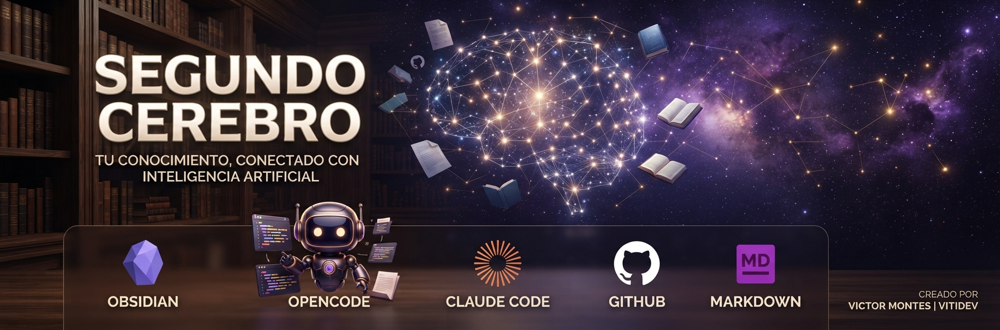
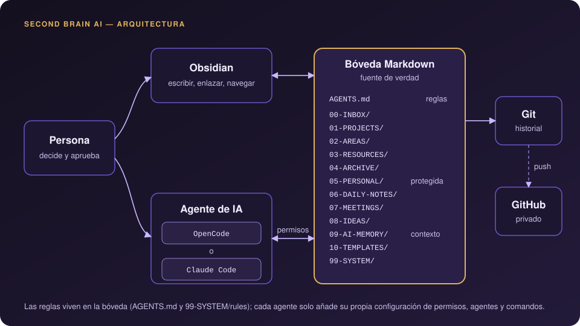
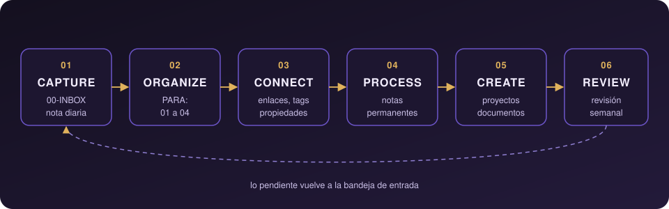
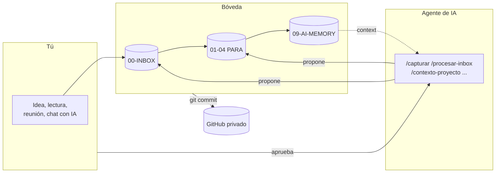

<p align="center">
  
</p>

<h1 align="center">SECOND BRAIN — AI-Powered Personal Knowledge System</h1>

<p align="center">
  Guía educativa y plantilla lista para construir tu segundo cerebro con Obsidian, Markdown, Git<br>
  y un agente de IA a tu elección: OpenCode o Claude Code.
</p>

<p align="center">
  <a href="LICENSE"></a>
  
  
  
  
  
</p>

<p align="center">
  
</p>

---

## Tabla de contenidos

- [Introducción](#introducción)
- [Objetivos](#objetivos)
- [Arquitectura](#arquitectura)
- [Cómo funciona](#cómo-funciona)
- [Requisitos](#requisitos)
- [Instalación paso a paso](#instalación-paso-a-paso)
- [Configuración de Obsidian](#configuración-de-obsidian)
- [Configuración de OpenCode](#configuración-de-opencode)
- [Configuración de Claude Code](#configuración-de-claude-code)
- [Estructura de carpetas](#estructura-de-carpetas)
- [Biblioteca de prompts](#biblioteca-de-prompts)
- [Agentes](#agentes)
- [Workflows](#workflows)
- [Seguridad](#seguridad)
- [Documentación completa](#documentación-completa)
- [Preguntas frecuentes](#preguntas-frecuentes)
- [Contribución](#contribución)
- [Licencia](#licencia)
- [Autor](#autor)

---

## Introducción

Un **segundo cerebro** es un sistema externo y confiable donde guardas lo que aprendes, piensas y haces, para **recuperarlo, conectarlo y reutilizarlo** cuando lo necesites.

Este repositorio enseña a construirlo desde cero, aunque nunca hayas usado una terminal:

| Pieza | Papel |
| --- | --- |
| **Markdown** | Formato abierto de tus notas: texto plano que durará décadas. |
| **Obsidian** | Interfaz para escribir, enlazar y navegar tus notas. |
| **Git y GitHub** | Historial de cambios y respaldo privado. |
| **OpenCode o Claude Code** | Agente de IA que lee tu bóveda, procesa notas, recupera contexto y propone cambios con tu aprobación. |

> **La bóveda es el segundo cerebro; la IA es un asistente intercambiable.** OpenCode y Claude Code son alternativas compatibles con la misma arquitectura: elige una, ambas o cambia cuando quieras sin perder nada.

## Objetivos

- Enseñar paso a paso a crear, usar y mantener un segundo cerebro con IA.
- Ofrecer una **plantilla de bóveda** organizada y lista para usar.
- Proporcionar **configuraciones verificadas** para OpenCode y Claude Code, con permisos seguros.
- Reunir **17 prompts**, **7 agentes** y **8 workflows** reutilizables.
- Servir como material para talleres universitarios y autoaprendizaje.

## Arquitectura

<p align="center">
  
</p>

Principios:

1. **Una sola fuente de verdad.** Las reglas que siguen los agentes viven dentro de la bóveda (`AGENTS.md` y `99-SYSTEM/rules/`). OpenCode las lee de forma nativa; Claude Code las importa desde `CLAUDE.md` con `@AGENTS.md`.
2. **Configuración separada por herramienta.** Cada agente tiene su propio formato de permisos, agentes y comandos. No se mezclan.
3. **Doble protección.** Las instrucciones orientan al modelo; los permisos de la herramienta lo obligan. `05-PERSONAL/` no se puede modificar y los comandos destructivos están denegados.
4. **Todo es reversible.** Git guarda cada versión; los agentes archivan en lugar de borrar.

## Cómo funciona

El sistema sigue un ciclo de seis pasos:

<p align="center">
  
</p>



| Paso | Qué haces | Herramienta |
| --- | --- | --- |
| Capture | Guardas sin clasificar. | `Ctrl+N` en Obsidian o `/capturar` |
| Organize | Decides proyecto, área, recurso o archivo. | `/procesar-inbox` |
| Connect | Enlazas con lo que ya sabes. | Prompt *Relacionar conocimientos* |
| Process | Escribes notas permanentes con tus palabras. | Prompt *Crear notas permanentes* |
| Create | Produces algo con lo acumulado. | Proyectos en `01-PROJECTS/` |
| Review | Revisas cada semana. | `/revision-semanal` |

## Requisitos

| Componente | Obligatorio | Nota |
| --- | --- | --- |
| [Obsidian](https://obsidian.md/download) | Sí | Gratuito para uso personal. |
| [Git](https://git-scm.com/downloads) | Sí | Historial y respaldo. |
| [OpenCode](https://opencode.ai/docs/) **o** [Claude Code](https://code.claude.com/docs/en/setup) | Al menos uno | Claude Code requiere un plan Pro o superior, o una cuenta de Console. OpenCode requiere una cuenta en el proveedor de modelos que elijas. |
| Cuenta de GitHub | Recomendado | Repositorio privado gratuito. |
| Python 3.10+ | Opcional | Para los scripts de instalación y validación. |

Detalle: [02 — Requisitos](docs/02-requirements.md).

## Instalación paso a paso

**1. Instala Obsidian, Git y Python** ([guía 03](docs/03-installation.md)).

```powershell
# PowerShell (Windows)
winget install Obsidian.Obsidian
winget install --id Git.Git -e
winget install --id Python.Python.3.12 -e
```

```bash
# Bash (macOS con Homebrew)
brew install --cask obsidian
brew install git python
```

**2. Descarga este repositorio.**

```bash
git clone https://github.com/<usuario>/second-brain-ai.git
cd second-brain-ai
```

**3. Crea tu bóveda fuera del repositorio.**

```powershell
# PowerShell (Windows)
python scripts/new-vault.py "$HOME\Documents\SegundoCerebro"
```

```bash
# Bash (macOS / Linux)
python3 scripts/new-vault.py ~/Documents/SegundoCerebro
```

**4. Ábrela en Obsidian:** *Open folder as vault* → `SegundoCerebro`.

**5. Instala la configuración de tu agente** (`opencode`, `claude-code` o `both`).

```powershell
# PowerShell (Windows)
python scripts/install-agents.py --tool claude-code --vault "$HOME\Documents\SegundoCerebro"
```

```bash
# Bash (macOS / Linux)
python3 scripts/install-agents.py --tool opencode --vault ~/Documents/SegundoCerebro
```

**6. Abre el agente en la raíz de la bóveda** y prueba un comando:

```text
/auditar-boveda
```

**7. Versiona y respalda** en un repositorio privado ([guía 09](docs/09-git-github.md)).

## Configuración de Obsidian

La plantilla ya trae configurados la carpeta de notas nuevas (`00-INBOX`), las plantillas (`10-TEMPLATES`) y las notas diarias (`06-DAILY-NOTES`). Solo tienes que activar los plugins oficiales:

| Plugin oficial | Uso |
| --- | --- |
| Templates | Insertar las 7 plantillas. |
| Daily notes | Nota diaria con plantilla. |
| Backlinks, Outgoing links, Graph view | Navegar las conexiones. |
| Properties view | Editar propiedades YAML. |
| Bases | Tablas de proyectos, bandeja y notas permanentes (`99-SYSTEM/bases/`). |

Guía completa: [04 — Configuración de Obsidian](docs/04-obsidian-setup.md) y [05 — Arquitectura de la bóveda](docs/05-vault-architecture.md).

## Configuración de OpenCode

```bash
# Bash (macOS / Linux)
curl -fsSL https://opencode.ai/v2/install | bash
```

```bash
# Cualquier sistema con Node.js (en Windows, también la descarga directa desde opencode.ai)
npm install -g @opencode/cli
```

| En tu bóveda | Contenido |
| --- | --- |
| `AGENTS.md` | Reglas compartidas (lectura nativa). |
| `opencode.json` | Permisos (`permissions`: reglas `action` / `resource` / `effect`) e `instructions`. |
| `.opencode/agents/` | 7 agentes con sus propios permisos. |
| `.opencode/commands/` | 7 comandos `/...`. |

Guía completa: [07 — OpenCode](docs/07-opencode-setup.md). Archivos: [opencode/](opencode/README.md).

## Configuración de Claude Code

```powershell
# PowerShell (Windows)
irm https://claude.ai/install.ps1 | iex
```

```bash
# Bash (macOS / Linux / WSL)
curl -fsSL https://claude.ai/install.sh | bash
```

| En tu bóveda | Contenido |
| --- | --- |
| `CLAUDE.md` | Importa `AGENTS.md` y las reglas de `99-SYSTEM/rules/`. |
| `.claude/settings.json` | Permisos `allow` / `ask` / `deny`. |
| `.claude/agents/` | 7 subagentes. |
| `.claude/skills/` | 7 skills `/...` (equivalentes a los comandos de OpenCode). |
| `.claude/rules/` | Reglas que se cargan al editar Markdown. |

Guía completa: [08 — Claude Code](docs/08-claude-code-setup.md). Archivos: [claude-code/](claude-code/README.md).

## Estructura de carpetas

### Este repositorio

```text
second-brain-ai/
├── README.md                Esta página
├── LICENSE                  MIT
├── CONTRIBUTING.md          Cómo contribuir
├── SECURITY.md              Política de seguridad
├── .gitignore               Exclusiones comentadas
├── .gitattributes           Saltos de línea normalizados
├── .env.example             Variables de entorno (sin valores)
├── assets/                  Banner y diagramas SVG
├── docs/                    13 guías paso a paso
├── vault-template/          Plantilla de bóveda (se copia a tu equipo)
├── ai/
│   ├── prompts/             17 prompts
│   ├── agents/              7 agentes (especificación neutral)
│   ├── workflows/           8 workflows (A–H)
│   ├── rules/               Mapa de reglas
│   └── examples/            Sesiones de ejemplo
├── opencode/                Configuración para OpenCode
├── claude-code/             Configuración para Claude Code
├── templates/               7 plantillas de notas (fuente)
├── examples/
│   ├── example-vault/       Bóveda de demostración con datos ficticios
│   ├── example-projects/    Anatomía de proyectos
│   └── example-workflows/   Archivos antes y después de un workflow
└── scripts/                 new-vault, install-agents, validate-structure
```

### Tu bóveda

| Carpeta | Contenido |
| --- | --- |
| `00-INBOX/` | Capturas sin procesar. |
| `01-PROJECTS/` | Proyectos con objetivo y fecha de fin. |
| `02-AREAS/` | Responsabilidades continuas y personas. |
| `03-RESOURCES/` | Notas permanentes, referencias y MOC. |
| `04-ARCHIVE/` | Material inactivo (no se borra). |
| `05-PERSONAL/` | Información sensible; los agentes no pueden modificarla. |
| `06-DAILY-NOTES/` | Una nota por día. |
| `07-MEETINGS/` | Actas de reuniones. |
| `08-IDEAS/` | Ideas en incubación. |
| `09-AI-MEMORY/` | Perfil, contexto activo, decisiones y sesiones para los agentes. |
| `10-TEMPLATES/` | Plantillas de Obsidian. |
| `99-SYSTEM/` | Índice, reglas, tags y Bases. |

## Biblioteca de prompts

Cada prompt incluye objetivo, cuándo usarlo, contexto necesario, instrucciones listas para copiar, restricciones, resultado esperado y ejemplo.

| | | |
| --- | --- | --- |
| 00 [Prompt maestro de sincronización](ai/prompts/00-prompt-maestro-sincronizacion.md) | 06 [Investigar un tema](ai/prompts/06-investigar-tema.md) | 12 [Preparar sesión de estudio](ai/prompts/12-preparar-sesion-estudio.md) |
| 01 [Capturar una idea](ai/prompts/01-capturar-idea.md) | 07 [Analizar un proyecto](ai/prompts/07-analizar-proyecto.md) | 13 [Mapa de conocimientos](ai/prompts/13-mapa-de-conocimientos.md) |
| 02 [Procesar notas desorganizadas](ai/prompts/02-procesar-notas-desorganizadas.md) | 08 [Crear un proyecto](ai/prompts/08-crear-proyecto.md) | 14 [Actualizar el índice](ai/prompts/14-actualizar-indice.md) |
| 03 [Resumir documentos](ai/prompts/03-resumir-documento.md) | 09 [Actualizar información](ai/prompts/09-actualizar-informacion.md) | 15 [Informe de actividad](ai/prompts/15-informe-actividad.md) |
| 04 [Crear notas permanentes](ai/prompts/04-crear-notas-permanentes.md) | 10 [Detectar duplicados](ai/prompts/10-detectar-duplicados.md) | 16 [Recuperar contexto](ai/prompts/16-recuperar-contexto-proyecto.md) |
| 05 [Relacionar conocimientos](ai/prompts/05-relacionar-conocimientos.md) | 11 [Revisión semanal](ai/prompts/11-revision-semanal.md) | |

Índice completo: [ai/prompts/](ai/prompts/README.md).

## Agentes

| Agente | Responsabilidad | Edita |
| --- | --- | --- |
| [Knowledge Manager](ai/agents/knowledge-manager.md) | Organiza, clasifica y enlaza el conocimiento. | Con confirmación |
| [Research Assistant](ai/agents/research-assistant.md) | Investiga y documenta con fuentes. | Solo `00-INBOX` |
| [Project Manager](ai/agents/project-manager.md) | Crea y mantiene proyectos y reuniones. | `01-PROJECTS`, `07-MEETINGS` |
| [Note Processor](ai/agents/note-processor.md) | Procesa la bandeja de entrada. | Con confirmación |
| [Learning Assistant](ai/agents/learning-assistant.md) | Organiza el aprendizaje y el repaso. | Notas de aprendizaje |
| [Memory Assistant](ai/agents/memory-assistant.md) | Recupera contexto con rutas. | No (solo lectura) |
| [Vault Auditor](ai/agents/vault-auditor.md) | Revisa estructura, calidad y privacidad. | No (solo lectura) |

Implementaciones: [opencode/agents/](opencode/agents/) y [claude-code/agents/](claude-code/agents/).

## Workflows

| | Situación |
| --- | --- |
| A | [Tengo una idea nueva y quiero guardarla](ai/workflows/A-guardar-idea.md) |
| B | [Investigué un tema y quiero incorporarlo al cerebro](ai/workflows/B-incorporar-investigacion.md) |
| C | [Comencé un proyecto y quiero mantener su contexto](ai/workflows/C-contexto-de-proyecto.md) |
| D | [Hablé con otra IA y quiero incorporar los resultados](ai/workflows/D-incorporar-conversacion-ia.md) |
| E | [Quiero que Claude Code actualice mi bóveda](ai/workflows/E-claude-code-actualiza-boveda.md) |
| F | [Quiero utilizar OpenCode para consultar mis proyectos](ai/workflows/F-opencode-consulta-proyectos.md) |
| G | [Quiero realizar una revisión semanal](ai/workflows/G-revision-semanal.md) |
| H | [Quiero respaldar mi bóveda en GitHub sin publicar información privada](ai/workflows/H-respaldo-github-privado.md) |

## Seguridad

| Riesgo | Protección |
| --- | --- |
| Publicar datos privados | Bóveda en repositorio **privado**; `05-PERSONAL/` excluida en `.gitignore`. |
| Filtrar API keys | Variables de entorno; `.env` ignorado y con lectura denegada a los agentes. |
| Cambios no deseados de un agente | Edición con confirmación; `05-PERSONAL/` denegada; Git para deshacer. |
| Borrados accidentales | Comandos de borrado, `git push`, `git reset --hard` y `git clean` denegados; los agentes archivan. |

Antes de tu primer `git push`, lee [12 — Seguridad y privacidad](docs/12-security-privacy.md). Para reportar un problema de seguridad de este repositorio: [SECURITY.md](SECURITY.md).

## Documentación completa

| | Guía | | Guía |
| --- | --- | --- | --- |
| 01 | [Introducción](docs/01-introduction.md) | 08 | [Claude Code](docs/08-claude-code-setup.md) |
| 02 | [Requisitos](docs/02-requirements.md) | 09 | [Git y GitHub](docs/09-git-github.md) |
| 03 | [Instalación](docs/03-installation.md) | 10 | [Workflows](docs/10-workflows.md) |
| 04 | [Obsidian](docs/04-obsidian-setup.md) | 11 | [Uso avanzado](docs/11-advanced-usage.md) |
| 05 | [Arquitectura de la bóveda](docs/05-vault-architecture.md) | 12 | [Seguridad y privacidad](docs/12-security-privacy.md) |
| 06 | [Integración con IA](docs/06-ai-integration.md) | 13 | [Solución de problemas](docs/13-troubleshooting.md) |
| 07 | [OpenCode](docs/07-opencode-setup.md) | | |

## Preguntas frecuentes

<details>
<summary><strong>¿Necesito OpenCode y Claude Code a la vez?</strong></summary>

No. Son alternativas. La bóveda funciona con cualquiera de los dos, y puedes cambiar de uno a otro sin modificar tus notas ni tus reglas.
</details>

<details>
<summary><strong>¿Necesito saber programar?</strong></summary>

No. Necesitas copiar y pegar comandos en una terminal. Cada comando indica si es para PowerShell, CMD o Bash.
</details>

<details>
<summary><strong>¿La IA puede borrar mis notas?</strong></summary>

Con la configuración de esta plantilla, no: los comandos de borrado están denegados, cada edición requiere tu confirmación y `05-PERSONAL/` no se puede modificar. Además, Git te permite deshacer cualquier cambio.
</details>

<details>
<summary><strong>¿Mis notas se envían a un servidor?</strong></summary>

Obsidian trabaja en local. Cuando usas un agente de IA, el contenido que el agente lee se envía al proveedor del modelo para generar la respuesta. Por eso `05-PERSONAL/` requiere tu confirmación para ser leída y `.env` está bloqueado. Revisa las políticas de privacidad del proveedor que uses.
</details>

<details>
<summary><strong>¿Puedo usar solo Obsidian, sin IA?</strong></summary>

Sí. La estructura, las plantillas y el ciclo de trabajo funcionan sin IA. Los agentes aceleran el procesamiento y la recuperación de contexto.
</details>

<details>
<summary><strong>¿Por qué el repositorio es público si mis notas son privadas?</strong></summary>

Este repositorio contiene solo la guía y una plantilla vacía. Tu bóveda real es una copia en tu equipo, respaldada en un repositorio privado distinto.
</details>

<details>
<summary><strong>¿Cómo compruebo que el repositorio está bien antes de publicarlo?</strong></summary>

Ejecuta `python scripts/validate-structure.py`. Comprueba enlaces, anclas, wikilinks, JSON, frontmatter, Mermaid, secretos, emojis y la sincronización de plantillas.
</details>

## Contribución

Las contribuciones son bienvenidas. Lee [CONTRIBUTING.md](CONTRIBUTING.md): verifica cada comando en la documentación oficial, no incluyas datos personales ni secretos, y ejecuta el validador antes de abrir un pull request.

## Licencia

Distribuido bajo la [licencia MIT](LICENSE). Copyright (c) 2026 Victor Montes.

La licencia cubre el contenido de este repositorio (documentación, plantillas, configuraciones de ejemplo y scripts). **No** cubre los programas externos que se mencionan: Obsidian, OpenCode, Claude Code, Git, GitHub y Python tienen sus propias licencias y términos de uso, y sus nombres y logotipos pertenecen a sus respectivos titulares.

## Autor

<table>
  <tr>
    <td>
      <strong>Victor Montes</strong><br>
      Developer identity: <strong>VITIDEV</strong>
    </td>
    <td>
      Creador de Second Brain AI. Desarrolla recursos educativos que combinan gestión del conocimiento personal, Markdown y agentes de IA, con el objetivo de que cualquier persona pueda construir un sistema propio, seguro y duradero para aprender y trabajar mejor.
    </td>
  </tr>
</table>

<p align="center">
  <sub>Created by Victor Montes · VITIDEV</sub>
</p>
