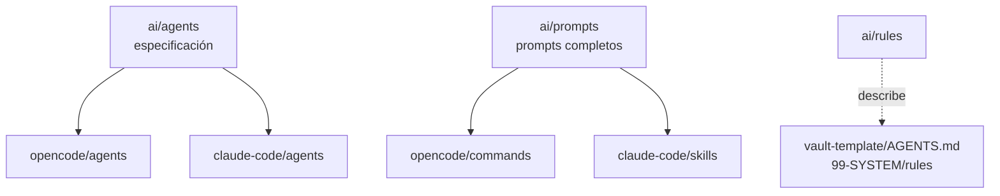

# Capa de IA

Todo lo necesario para que un agente de IA trabaje sobre tu segundo cerebro, descrito de forma **independiente de la herramienta**.

| Carpeta | Contenido |
| --- | --- |
| [prompts/](prompts/README.md) | 17 prompts listos para copiar (16 tareas + prompt maestro). |
| [agents/](agents/README.md) | Especificación de los 7 agentes especializados. |
| [workflows/](workflows/README.md) | 8 tutoriales paso a paso (A–H) para situaciones reales. |
| [rules/](rules/README.md) | Mapa de las reglas que siguen los agentes y dónde viven. |
| [examples/](examples/README.md) | Sesiones de ejemplo: petición, respuesta del agente y resultado. |

## Relación con las carpetas de cada herramienta

- **`ai/`** explica *qué* hace cada pieza.
- **`opencode/`** y **`claude-code/`** contienen *cómo* se implementa en cada herramienta.
- **`vault-template/`** contiene las reglas que leen ambos agentes.
