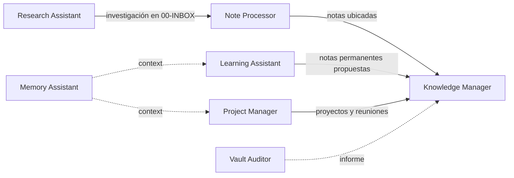

# Agentes especializados

Especificación **independiente de la herramienta** de los siete agentes del sistema. Cada archivo define misión, capacidades, límites, entradas y salidas, y enlaza a sus implementaciones concretas:

- OpenCode: [opencode/agents/](../../opencode/agents/)
- Claude Code: [claude-code/agents/](../../claude-code/agents/)

## Resumen

| Agente | Identificador | Misión | Puede editar |
| --- | --- | --- | --- |
| [Knowledge Manager](knowledge-manager.md) | `knowledge-manager` | Mantener la bóveda organizada según PARA, enlazada y sin duplicados. | Sí, con confirmación |
| [Research Assistant](research-assistant.md) | `research-assistant` | Convertir preguntas en notas de investigación verificables. | Solo crea en `00-INBOX` |
| [Project Manager](project-manager.md) | `project-manager` | Proyectos con objetivo, próximas acciones y decisiones al día. | `01-PROJECTS`, `07-MEETINGS` |
| [Note Processor](note-processor.md) | `note-processor` | Convertir capturas en notas bien formadas y ubicadas. | Sí, con confirmación |
| [Learning Assistant](learning-assistant.md) | `learning-assistant` | Convertir material de estudio en conocimiento propio y repasable. | Notas de aprendizaje |
| [Memory Assistant](memory-assistant.md) | `memory-assistant` | Recuperar contexto exacto con rutas. | No (solo lectura) |
| [Vault Auditor](vault-auditor.md) | `vault-auditor` | Detectar problemas de estructura, calidad y privacidad. | No (solo lectura) |

## Cómo colaboran

## Diferencias de implementación

| Aspecto | OpenCode | Claude Code |
| --- | --- | --- |
| Restricción por carpeta | Reglas `permissions` propias de cada agente (se aplican de forma estricta). | Global en `settings.json`; por agente solo se restringen las **herramientas** (`tools`). |
| Solo lectura | `edit * deny`, `shell * deny`. | `tools: Read, Glob, Grep`. |
| Invocación | `agent:` en un comando, o pedir al agente principal que delegue. | Automática por `description`, por nombre en el prompt, `@agent-<nombre>` o `context: fork` en una skill. |

Por esa diferencia, en Claude Code los límites de carpeta de `project-manager`, `research-assistant` y `learning-assistant` se apoyan en sus instrucciones y en la confirmación (`ask`) de cada edición. Ver [08 — Claude Code](../../docs/08-claude-code-setup.md#63-subagentes-claudeagents).

## Diseñar un agente nuevo

1. Escribe la especificación aquí con la misma estructura.
2. Define primero los **límites**: qué no debe hacer nunca.
3. Implementa en cada herramienta que uses.
4. Pruébalo con una tarea que debería rechazar.

Guía paso a paso: [11 — Uso avanzado](../../docs/11-advanced-usage.md#1-crear-tu-propio-agente).
