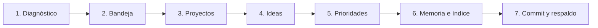

# Workflow G — Quiero realizar una revisión semanal

| | |
| --- | --- |
| **Paso del ciclo** | REVIEW (y cierre del ciclo completo) |
| **Tiempo** | 30–45 minutos |
| **Herramientas** | Cualquier agente, Obsidian, Git |

## Objetivo

Terminar la semana con la bandeja vacía, los proyectos revisados, las prioridades claras y la memoria de IA actualizada. Es el hábito que mantiene vivo el segundo cerebro.

## Antes de empezar

- Elige un día y hora fijos (por ejemplo, viernes a última hora).
- Haz un commit: `git add .` y `git commit -m "Antes de revisión semanal"`.

## Pasos



### 1. Diagnóstico

```text
/revision-semanal
```

El agente analiza la semana sin modificar nada y presenta: capturas pendientes, tareas sin completar de las notas diarias, proyectos que requieren atención, ideas listas para decidir y tareas de reuniones sin reflejar.

### 2. Bandeja de entrada

Si hay capturas pendientes:

```text
/procesar-inbox
```

Aprueba fila por fila. Objetivo: `00-INBOX/` vacía (salvo su `LEEME`).

### 3. Proyectos

Para cada proyecto que el diagnóstico marcó:

- ¿Sigue activo? Si terminó, pide archivarlo (pasa a `04-ARCHIVE/`, estado `completado`).
- ¿Tiene una próxima acción concreta? Si no, defínela.
- ¿Hay decisiones de la semana sin registrar? Pídele al agente que las añada.

### 4. Ideas

Para cada idea de `08-IDEAS/` que el agente señaló, decide: **convertir en proyecto** (`/nuevo-proyecto`), **seguir incubando** o **archivar**.

### 5. Prioridades

Responde a la pregunta del informe: ¿cuáles son tus tres prioridades para la próxima semana?

### 6. Memoria e índice

Aprueba la nueva versión de `09-AI-MEMORY/contexto-activo.md` que propone el agente. Si se crearon o archivaron proyectos o MOC:

```text
Actualiza el índice de la bóveda (99-SYSTEM/Indice.md) según el prompt 14.
```

### 7. Commit y respaldo

```bash
git status
git diff --stat
git add .
git commit -m "Revisión semanal 2026-11-20"
git push
```

Ver [Workflow H](H-respaldo-github-privado.md) para la primera configuración del respaldo.

## Lista de comprobación

- [ ] `00-INBOX/` vacía.
- [ ] Cada proyecto activo tiene al menos una próxima acción.
- [ ] Proyectos terminados archivados.
- [ ] Ideas revisadas.
- [ ] Tres prioridades definidas en `contexto-activo.md`.
- [ ] Sesión registrada en `09-AI-MEMORY/sesiones/`.
- [ ] Commit y push hechos.

## Variante con el prompt maestro

Si prefieres una única sesión guiada por fases que también incluya conexiones e índice, usa `/sincronizar` o el [prompt maestro](../prompts/00-prompt-maestro-sincronizacion.md).

## Errores frecuentes

| Error | Solución |
| --- | --- |
| Saltarse la revisión "porque no hay tiempo". | Haz la versión mínima: pasos 1, 2 y 7 (15 minutos). |
| Convertirla en una sesión de trabajo. | La revisión decide; el trabajo se hace después. |
| Aprobar el `contexto-activo.md` sin leerlo. | Es lo que leerán los agentes toda la semana siguiente. |

## Resultado esperado

Bóveda ordenada, prioridades claras, memoria de IA al día y un commit que marca el cierre de la semana.

---

Anterior: [F](F-opencode-consulta-proyectos.md) | [Workflows](README.md) | Siguiente: [H — Respaldo privado en GitHub](H-respaldo-github-privado.md)
