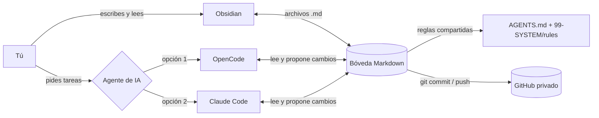
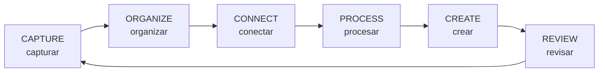

# 01 — Introducción: qué es un segundo cerebro con IA

> **Objetivo de esta guía:** entender qué vas a construir, por qué funciona y cómo encajan las piezas antes de instalar nada.
> **Tiempo estimado:** 15 minutos de lectura.

[Inicio](../README.md) | Siguiente: [02 — Requisitos](02-requirements.md)

---

## 1. Qué es

Un **segundo cerebro** es un sistema externo y confiable donde guardas lo que aprendes, piensas y haces, de forma que puedas **recuperarlo, conectarlo y reutilizarlo** cuando lo necesites. El término se popularizó con el método *Building a Second Brain* de Tiago Forte, aunque la idea de llevar notas interconectadas es mucho más antigua (por ejemplo, el *Zettelkasten* de Niklas Luhmann).

En este proyecto, el segundo cerebro es:

- Una **carpeta de archivos Markdown** en tu ordenador (la *bóveda*).
- Abierta con **Obsidian**, que te permite navegarla, enlazar notas y visualizarlas.
- Versionada con **Git** y respaldada en **GitHub** (en un repositorio privado).
- Asistida por un **agente de IA**: **OpenCode** o **Claude Code**, el que prefieras.

## 2. Para qué sirve

| Problema habitual | Cómo lo resuelve el segundo cerebro |
| --- | --- |
| "Lo leí en algún sitio pero no lo encuentro." | Todo se captura en un único lugar y se puede buscar. |
| "Cada proyecto nuevo empieza desde cero." | Los proyectos anteriores dejan contexto reutilizable. |
| "Tengo notas en cinco aplicaciones distintas." | Un único formato abierto: archivos `.md`. |
| "La IA no recuerda lo que hablamos la semana pasada." | La bóveda es la memoria; el agente la lee cada vez. |
| "Me da miedo que la IA borre o invente cosas." | Permisos configurados y revisión de cambios con Git. |

## 3. Por qué esta combinación de herramientas

- **Markdown** es texto plano: lo puede leer cualquier programa, hoy y dentro de veinte años. No dependes de ninguna empresa.
- **Obsidian** trabaja directamente sobre esos archivos. Si mañana dejas de usarlo, tus notas siguen intactas.
- **Git** guarda cada versión de cada nota. Si un agente comete un error, puedes deshacerlo.
- **Un agente de IA en la terminal** (OpenCode o Claude Code) puede leer cientos de notas, resumirlas, relacionarlas y proponer cambios, siempre dentro de los permisos que tú definas.

> **Idea clave:** la IA no es el segundo cerebro. La bóveda es el segundo cerebro. La IA es un asistente que trabaja *sobre* ella, y puede cambiarse por otra sin perder nada.

## 4. Cómo encajan las piezas

La bóveda contiene un archivo `AGENTS.md` con las reglas de trabajo. **Ambos agentes lo leen**, por eso puedes cambiar de uno a otro sin reescribir tus instrucciones. Los detalles están en [06 — Integración con IA](06-ai-integration.md).

## 5. El ciclo de trabajo

Todo el sistema gira alrededor de seis pasos:

| Paso | Qué haces | Dónde ocurre |
| --- | --- | --- |
| Capture | Guardas rápido, sin pensar dónde va. | `00-INBOX/`, notas diarias |
| Organize | Decides a qué proyecto, área o recurso pertenece. | Carpetas `01` a `04` |
| Connect | Enlazas la nota con otras relacionadas. | Enlaces `[[nota]]`, tags |
| Process | Reescribes la idea con tus palabras. | Notas permanentes |
| Create | Usas lo acumulado para producir algo nuevo. | Proyectos, documentos |
| Review | Revisas semanalmente qué quedó pendiente. | Revisión semanal |

Este ciclo se explica en detalle en [05 — Arquitectura de la bóveda](05-vault-architecture.md).

## 6. Qué vas a tener al terminar

- Una bóveda de Obsidian organizada, con plantillas y notas diarias.
- Un agente de IA (OpenCode, Claude Code o ambos) configurado con permisos seguros.
- Siete agentes especializados y comandos listos para usar.
- Una biblioteca de 17 prompts reutilizables.
- Un respaldo privado en GitHub que no publica información sensible.

## 7. Errores frecuentes al empezar

| Error | Por qué ocurre | Cómo evitarlo |
| --- | --- | --- |
| Diseñar el sistema perfecto antes de escribir una nota. | Parálisis por análisis. | Empieza con la plantilla y ajústala después de un mes de uso. |
| Pedirle a la IA que "organice todo" el primer día. | No hay reglas ni contexto todavía. | Primero configura `AGENTS.md`; luego trabaja carpeta por carpeta. |
| Copiar textos enteros sin procesarlos. | Acumular no es aprender. | Usa notas permanentes con tus propias palabras. |
| Subir la bóveda a un repositorio público. | Confusión entre plantilla y bóveda real. | Lee [12 — Seguridad y privacidad](12-security-privacy.md). |

## 8. Buenas prácticas

- Captura rápido, procesa con calma.
- Una idea por nota permanente.
- Enlaza siempre la nota nueva con al menos una existente.
- Revisa cada semana; un sistema sin revisión se convierte en un cajón desordenado.
- Trata a la IA como un asistente: tú apruebas los cambios.

## 9. Resultado esperado

Al terminar esta guía debes poder explicar con tus palabras:

- Qué es la bóveda y por qué es independiente de la IA.
- Qué papel cumplen Obsidian, Git y el agente.
- Qué significa cada paso del ciclo CAPTURE → REVIEW.

---

[Inicio](../README.md) | Siguiente: [02 — Requisitos](02-requirements.md)
