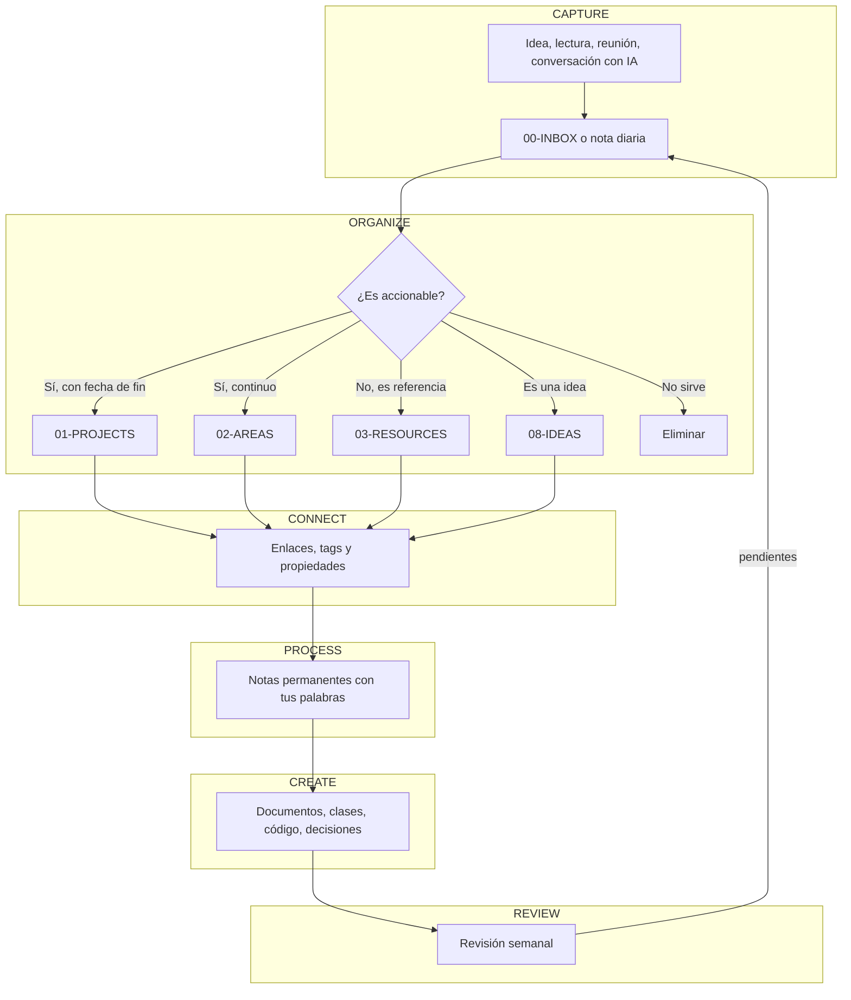

# 05 — Arquitectura de la bóveda

> **Objetivo:** entender qué va en cada carpeta, cómo se nombran y enlazan las notas, qué propiedades usar y cómo funciona el ciclo CAPTURE → ORGANIZE → CONNECT → PROCESS → CREATE → REVIEW.
> **Tiempo estimado:** 40 minutos. Es la guía más importante: los agentes de IA siguen exactamente estas reglas.

Anterior: [04 — Configuración de Obsidian](04-obsidian-setup.md) | [Inicio](../README.md) | Siguiente: [06 — Integración con IA](06-ai-integration.md)

---

## 1. Principios de diseño

1. **Una nota, un lugar.** Cada nota vive en una única carpeta. Las relaciones se expresan con enlaces y propiedades, nunca copiando la nota.
2. **Carpetas por accionabilidad, no por tema.** La carpeta responde a "¿qué hago con esto?" (proyecto activo, área de responsabilidad, referencia, archivo). El tema se expresa con tags y enlaces. Es el método **PARA** (*Projects, Areas, Resources, Archive*) de Tiago Forte.
3. **Todo entra por la bandeja.** Capturar no exige decidir. Decidir ocurre al procesar.
4. **El sistema se describe a sí mismo.** `AGENTS.md` y `99-SYSTEM/` explican las reglas a cualquier persona o agente que abra la bóveda.

## 2. Mapa de carpetas

```text
SegundoCerebro/
├── AGENTS.md            Reglas compartidas para cualquier agente de IA
├── 00-INBOX/            Bandeja de entrada: todo lo nuevo sin clasificar
├── 01-PROJECTS/         Proyectos activos con objetivo y fecha de fin
├── 02-AREAS/            Responsabilidades continuas sin fecha de fin
├── 03-RESOURCES/        Material de referencia y notas permanentes por tema
├── 04-ARCHIVE/          Proyectos terminados y material inactivo
├── 05-PERSONAL/         Información sensible (salud, finanzas, familia)
├── 06-DAILY-NOTES/      Una nota por día
├── 07-MEETINGS/         Actas de reuniones
├── 08-IDEAS/            Ideas en incubación
├── 09-AI-MEMORY/        Contexto persistente para los agentes
├── 10-TEMPLATES/        Plantillas de Obsidian
└── 99-SYSTEM/           Índice, reglas, tags y Bases
```

### Qué va y qué no va en cada carpeta

| Carpeta | Va aquí | No va aquí | Sale de aquí cuando... |
| --- | --- | --- | --- |
| `00-INBOX` | Capturas rápidas, enlaces, fragmentos, notas de voz transcritas. | Nada debería quedarse más de una semana. | Se procesa: se mueve, se fusiona o se elimina. |
| `01-PROJECTS` | Una subcarpeta por proyecto, con una nota principal del mismo nombre. | Temas sin fecha de fin ("Salud", "Python"). | El proyecto termina → `04-ARCHIVE`. |
| `02-AREAS` | Notas de responsabilidades continuas: "Docencia", "Finanzas del hogar", "Salud". | Tareas puntuales (son de un proyecto). | Dejas de tener esa responsabilidad → `04-ARCHIVE`. |
| `03-RESOURCES` | Notas permanentes, resúmenes de libros, fuentes, mapas de contenido (MOC). | Información privada. | Deja de ser útil → `04-ARCHIVE`. |
| `04-ARCHIVE` | Todo lo inactivo, conservando su estructura. | Nada se borra sin revisión. | Se reactiva → vuelve a su carpeta. |
| `05-PERSONAL` | Datos sensibles. **Los agentes no pueden modificarla.** | Contraseñas (usa un gestor de contraseñas). | Nunca se publica. |
| `06-DAILY-NOTES` | Registro diario: qué hiciste, qué aprendiste, capturas del día. | Conocimiento permanente (extráelo a `03-RESOURCES`). | No sale; es un diario. |
| `07-MEETINGS` | Una nota por reunión: asistentes, decisiones, tareas. | Notas de una persona (van como nota de persona en `02-AREAS/Personas`). | No sale; se enlaza desde el proyecto. |
| `08-IDEAS` | Ideas que todavía no son proyecto. | Ideas ya en ejecución (son proyecto). | Se convierte en proyecto → `01-PROJECTS`. |
| `09-AI-MEMORY` | Perfil de trabajo, decisiones, contexto activo, registros de sesión. | Conocimiento general (va a `03-RESOURCES`). | Se resume y se depura mensualmente. |
| `10-TEMPLATES` | Plantillas. | Notas reales. | — |
| `99-SYSTEM` | Índice, reglas para agentes, taxonomía de tags, Bases. | Contenido de conocimiento. | — |

## 3. Nombres de archivo

| Tipo de nota | Formato | Ejemplo |
| --- | --- | --- |
| Nota permanente | Afirmación o concepto en lenguaje natural | `La práctica espaciada mejora la retención.md` |
| Proyecto | Carpeta y nota principal con el mismo nombre | `01-PROJECTS/Taller de Python/Taller de Python.md` |
| Nota diaria | `YYYY-MM-DD` | `2026-11-16.md` |
| Reunión | `YYYY-MM-DD Tema` | `2026-11-16 Planificación del taller.md` |
| Persona | Nombre y apellido | `Ana Pérez.md` (ficticia) |
| Idea | Frase corta | `Bot que resume mis notas diarias.md` |
| Mapa de contenido | `MOC - Tema` | `MOC - Aprendizaje.md` |

Reglas: sin caracteres `\ / : * ? " < > |` (prohibidos en Windows), sin `#` ni `^` (rompen enlaces), y nombres únicos en toda la bóveda.

## 4. Tipos de nota

| Tipo (`tipo:`) | Plantilla | Propósito |
| --- | --- | --- |
| `diaria` | `daily-note` | Registro del día. |
| `proyecto` | `project` | Objetivo, alcance, tareas, decisiones y contexto de un proyecto. |
| `area` | (ninguna) | Estándares, objetivos y proyectos de una responsabilidad continua. |
| `reunion` | `meeting` | Acta de reunión. |
| `persona` | `person` | Contexto profesional sobre una persona (sin datos sensibles). |
| `permanente` | `permanent-note` | Una idea propia, atómica y enlazada. |
| `aprendizaje` | `learning-note` | Notas de un curso, libro o tema en estudio. |
| `idea` | `idea` | Idea en incubación. |
| `captura` | (ninguna) | Nota rápida en `00-INBOX`. |
| `moc` | (ninguna) | Mapa de contenido: índice temático de enlaces. |
| `sistema` | (ninguna) | Notas de funcionamiento de la bóveda (`99-SYSTEM/`, `09-AI-MEMORY/`, `LEEME`). |

## 5. Enlaces: cómo conectar sin duplicar

- **Enlaza en lugar de copiar.** Si un dato ya existe en otra nota, escribe `[[Nota]]`.
- **Enlace hacia arriba.** Toda nota enlaza a su contexto: una nota permanente a su MOC, una reunión a su proyecto, un proyecto a su área.
- **Enlace lateral.** Las notas permanentes enlazan a otras relacionadas con una frase que explique la relación: `Contradice parcialmente [[Multitarea]]`.
- **MOC cuando un tema supera unas 10 notas.** Un MOC (*Map of Content*) es una nota que organiza enlaces sobre un tema con breves explicaciones.

## 6. Propiedades estándar

Todas las notas (excepto las capturas rápidas) usan este esquema. Los agentes lo respetan porque está en `99-SYSTEM/rules/conventions.md`.

| Propiedad | Tipo | Valores | Obligatoria |
| --- | --- | --- | --- |
| `tipo` | texto | ver sección 4 | Sí |
| `estado` | texto | `borrador`, `activo`, `en-pausa`, `completado`, `archivado`, `procesada` | Sí |
| `creado` | fecha | `YYYY-MM-DD` | Sí |
| `actualizado` | fecha | `YYYY-MM-DD` | Sí |
| `tags` | lista | taxonomía de `99-SYSTEM/tags.md` | No |
| `area` | enlace | `"[[Área]]"` | Proyectos |
| `proyecto` | enlace | `"[[Proyecto]]"` | Reuniones y tareas |
| `fuente` | texto o URL | origen de la información | Recursos y aprendizaje |
| `relacionado` | lista de enlaces | `- "[[Nota]]"` | No |
| `fecha_limite` | fecha | `YYYY-MM-DD` | Proyectos con plazo |

> Los enlaces dentro de propiedades van **entre comillas**: `area: "[[Docencia]]"`. Sin comillas, YAML interpreta los corchetes como una lista.

## 7. El ciclo de trabajo



| Paso | Pregunta guía | Frecuencia | Prompt asociado |
| --- | --- | --- | --- |
| CAPTURE | ¿Vale la pena recordarlo? | Continuo | [Capturar una idea](../ai/prompts/01-capturar-idea.md) |
| ORGANIZE | ¿Qué voy a hacer con esto? | Diario o cada 2–3 días | [Procesar notas desorganizadas](../ai/prompts/02-procesar-notas-desorganizadas.md) |
| CONNECT | ¿Con qué se relaciona? | Al procesar | [Relacionar conocimientos](../ai/prompts/05-relacionar-conocimientos.md) |
| PROCESS | ¿Qué entendí yo? | Semanal | [Crear notas permanentes](../ai/prompts/04-crear-notas-permanentes.md) |
| CREATE | ¿Qué puedo producir con lo que sé? | Según proyectos | [Analizar un proyecto](../ai/prompts/07-analizar-proyecto.md) |
| REVIEW | ¿Qué quedó pendiente? | Semanal | [Revisión semanal](../ai/prompts/11-revision-semanal.md) |

## 8. Cómo evitar duplicar conocimiento

1. **Busca antes de crear.** `Ctrl+O` (abrir rápido) muestra si ya existe una nota con ese nombre.
2. **Fusiona en vez de repetir.** Si dos notas dicen lo mismo, conserva la mejor, añade lo nuevo de la otra y convierte la segunda en un enlace o elimínala tras revisar backlinks.
3. **La nota diaria no es un depósito.** Si algo de la nota diaria es conocimiento duradero, extráelo a una nota permanente y deja un enlace.
4. **Un proyecto no copia recursos.** Enlaza a `03-RESOURCES` en lugar de pegar el contenido.
5. **Auditoría periódica.** El prompt [Detectar información duplicada](../ai/prompts/10-detectar-duplicados.md) y el agente *Vault Auditor* buscan títulos similares y contenido repetido.

## 9. Memoria para la IA (`09-AI-MEMORY`)

Los agentes no recuerdan conversaciones anteriores. Esta carpeta les da contexto estable:

| Archivo | Contenido | Quién lo actualiza |
| --- | --- | --- |
| `perfil-de-trabajo.md` | Cómo trabajas, preferencias de formato, idioma. Sin datos sensibles. | Tú |
| `contexto-activo.md` | Proyectos en curso y prioridades de las próximas semanas. | Tú o el agente con tu aprobación |
| `decisiones.md` | Registro de decisiones importantes y su motivo. | Tú o el agente con tu aprobación |
| `sesiones/YYYY-MM-DD-tema.md` | Resumen de sesiones largas con un agente. | El agente al final de la sesión |

Las sesiones están excluidas de Git por defecto en el `.gitignore` de este repositorio de plantilla; en tu bóveda privada puedes versionarlas.

## 10. Errores frecuentes

| Error | Consecuencia | Solución |
| --- | --- | --- |
| Crear carpetas por tema (`Python/`, `Historia/`). | Notas que encajan en varios temas quedan duplicadas. | Tema = tag o MOC; carpeta = accionabilidad. |
| Bandeja de entrada con cientos de notas. | El sistema deja de ser confiable. | Procesa al menos una vez por semana. |
| Notas permanentes que son copias de textos. | No hay aprendizaje real. | Reescribe con tus palabras y cita la fuente. |
| Datos sensibles fuera de `05-PERSONAL`. | Un agente o un `git push` puede exponerlos. | Revisa con el agente *Vault Auditor*. |

## 11. Resultado esperado

Puedes tomar cualquier información nueva y decidir en menos de 30 segundos en qué carpeta va, qué tipo de nota es y con qué otras notas debe enlazarse.

---

Anterior: [04 — Configuración de Obsidian](04-obsidian-setup.md) | [Inicio](../README.md) | Siguiente: [06 — Integración con IA](06-ai-integration.md)
