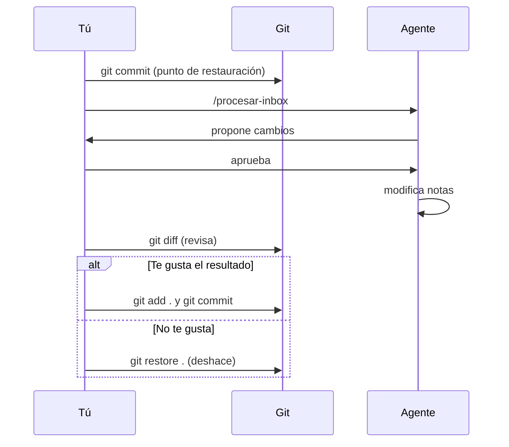

# 09 — Git y GitHub: historial y respaldo

> **Objetivo:** versionar tu bóveda con Git, respaldarla en un repositorio **privado** de GitHub y aprender a deshacer cambios de un agente.
> **Tiempo estimado:** 30 minutos.

Anterior: [08 — Claude Code](08-claude-code-setup.md) | [Inicio](../README.md) | Siguiente: [10 — Workflows](10-workflows.md)

---

## 1. Qué son Git y GitHub

| Herramienta | Qué es | Analogía |
| --- | --- | --- |
| **Git** | Programa local que guarda "fotografías" (*commits*) de tus archivos. | Un historial de versiones infinito. |
| **GitHub** | Servicio web que aloja repositorios Git. | Una copia de seguridad remota de ese historial. |

## 2. Por qué lo necesitamos

- **Deshacer errores de la IA.** Si un agente modifica 30 notas y no te gusta el resultado, vuelves al estado anterior con un comando.
- **Ver qué cambió.** `git diff` muestra línea por línea lo que modificó el agente.
- **Respaldo.** Si tu disco falla, tu bóveda está en GitHub.

## 3. Dos repositorios distintos

No confundas estos dos repositorios:

| Repositorio | Contenido | Visibilidad |
| --- | --- | --- |
| `second-brain-ai` (este) | Guía, plantilla y configuraciones de ejemplo. | Público |
| Tu bóveda (`SegundoCerebro`) | Tus notas reales. | **Privado siempre** |

## 4. Inicializar Git en tu bóveda

La plantilla ya incluye un `.gitignore` que excluye `05-PERSONAL/`, archivos `.env`, el estado volátil de Obsidian y la configuración local de los agentes. Revísalo antes del primer commit.

```bash
# Bash, PowerShell o CMD, desde la raíz de la bóveda
cd <ruta-de-tu-bóveda>
git init
git add .
git status
```

Lee la salida de `git status` con atención: es la lista de lo que se guardará. Si aparece algo que no debería estar, añádelo al `.gitignore` y repite `git add .`.

```bash
git commit -m "Bóveda inicial creada desde la plantilla"
```

## 5. Crear el repositorio privado en GitHub

### Opción A — Interfaz web

1. Entra en [github.com/new](https://github.com/new).
2. Nombre: `SegundoCerebro` (o el que prefieras).
3. Visibilidad: **Private**.
4. **No** marques "Add a README", ".gitignore" ni "license" (ya tienes contenido local).
5. Pulsa **Create repository** y copia la URL que aparece.

Conecta y sube:

```bash
git branch -M main
git remote add origin https://github.com/<tu-usuario>/SegundoCerebro.git
git push -u origin main
```

La primera vez, Git abrirá el navegador o pedirá credenciales. En Windows, Git Credential Manager (incluido con Git for Windows) gestiona el inicio de sesión.

### Opción B — GitHub CLI

Si tienes [GitHub CLI](https://cli.github.com/) instalado y autenticado (`gh auth login`):

```bash
gh repo create SegundoCerebro --private --source=. --remote=origin --push
```

### Comprobación

Abre el repositorio en GitHub. Debe mostrar el candado de **Private** y **no** debe contener archivos de `05-PERSONAL/` (salvo `LEEME-personal.md`).

## 6. Rutina diaria

```bash
git status                       # qué cambió
git diff                         # cómo cambió (pulsa q para salir)
git add .
git commit -m "Revisión semanal 2026-11-16"
git push
```

> **Los agentes no pueden hacer `git push`** con la configuración de la plantilla: está denegado en OpenCode y Claude Code. Publicar es siempre una decisión tuya.

## 7. Trabajar con agentes de forma segura



### Deshacer cambios

| Situación | Comando |
| --- | --- |
| Descartar todos los cambios sin commit en archivos ya versionados | `git restore .` |
| Descartar cambios de un archivo | `git restore "ruta/nota.md"` |
| Ver archivos nuevos sin versionar | `git status` (aparecen como *untracked*) |
| Recuperar una nota tal como estaba en un commit anterior | `git log --oneline -- "ruta/nota.md"` y luego `git restore --source <commit> "ruta/nota.md"` |
| Deshacer un commit ya hecho creando uno inverso | `git revert <commit>` |

> `git restore .` no borra archivos nuevos que el agente haya creado; esos aparecen en `git status` y puedes eliminarlos tú a mano tras revisarlos.

## 8. Privacidad del correo en los commits

Cada commit incluye el correo configurado con `git config user.email`. Para no exponerlo, en GitHub ve a **Settings → Emails**, activa **Keep my email addresses private** y usa la dirección `...@users.noreply.github.com` que te muestra:

```bash
git config --global user.email "<id>+<usuario>@users.noreply.github.com"
```

## 9. Errores frecuentes

| Error | Causa | Solución |
| --- | --- | --- |
| `fatal: not a git repository` | No estás en la carpeta de la bóveda. | `cd` a la raíz de la bóveda. |
| `rejected ... fetch first` al hacer push | GitHub tiene commits que tú no tienes (creaste el repo con README). | `git pull --rebase origin main` y vuelve a hacer push. |
| `Permission denied` o `Authentication failed` | Credenciales incorrectas. | Usa Git Credential Manager o `gh auth login`. GitHub no acepta contraseñas en la terminal. |
| Subiste algo privado. | Faltaba en `.gitignore`. | Ver [12 — Seguridad](12-security-privacy.md#9-si-subiste-un-secreto-o-dato-privado-por-error). |

## 10. Buenas prácticas

- Commit antes y después de cada sesión con un agente.
- Mensajes de commit descriptivos: `Procesada bandeja de entrada`, `Nuevo proyecto: Taller de Python`.
- Revisa `git diff --staged` antes de cada commit importante.
- El repositorio de la bóveda es **siempre privado**.

## 11. Resultado esperado

- Tu bóveda es un repositorio Git con al menos un commit.
- Existe una copia en un repositorio privado de GitHub.
- Sabes ver y deshacer los cambios de un agente.

---

Anterior: [08 — Claude Code](08-claude-code-setup.md) | [Inicio](../README.md) | Siguiente: [10 — Workflows](10-workflows.md)
