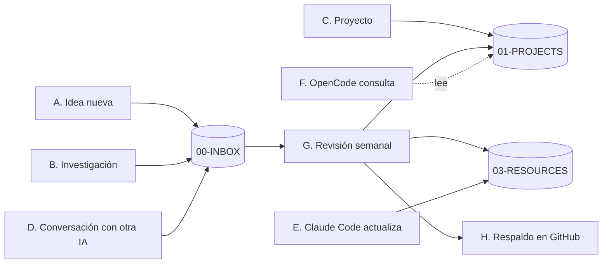

# 10 — Workflows prácticos

> **Objetivo:** aplicar todo lo anterior en situaciones reales. Cada workflow es un tutorial paso a paso con prompts listos para copiar, ejemplos de archivos y resultado esperado.

Anterior: [09 — Git y GitHub](09-git-github.md) | [Inicio](../README.md) | Siguiente: [11 — Uso avanzado](11-advanced-usage.md)

---

## 1. Mapa de workflows

| | Situación | Paso del ciclo | Herramienta | Tiempo |
| --- | --- | --- | --- | --- |
| A | [Tengo una idea nueva y quiero guardarla](../ai/workflows/A-guardar-idea.md) | Capture | Obsidian, cualquier agente | 1 min |
| B | [Investigué un tema y quiero incorporarlo](../ai/workflows/B-incorporar-investigacion.md) | Capture, Process, Connect | Cualquier agente | 20 min |
| C | [Comencé un proyecto y quiero mantener su contexto](../ai/workflows/C-contexto-de-proyecto.md) | Organize, Create | Cualquier agente | 15 min |
| D | [Hablé con otra IA y quiero incorporar los resultados](../ai/workflows/D-incorporar-conversacion-ia.md) | Capture, Process | Cualquier agente | 10 min |
| E | [Quiero que Claude Code actualice mi bóveda](../ai/workflows/E-claude-code-actualiza-boveda.md) | Organize, Connect | Claude Code | 15 min |
| F | [Quiero usar OpenCode para consultar mis proyectos](../ai/workflows/F-opencode-consulta-proyectos.md) | Review | OpenCode | 5 min |
| G | [Quiero realizar una revisión semanal](../ai/workflows/G-revision-semanal.md) | Review | Cualquier agente | 30–45 min |
| H | [Quiero respaldar mi bóveda en GitHub sin publicar información privada](../ai/workflows/H-respaldo-github-privado.md) | — | Git | 15 min |

## 2. Cómo se conectan

## 3. Rutina recomendada

| Frecuencia | Qué hacer | Workflow |
| --- | --- | --- |
| Cada vez que surge algo | Capturar sin clasificar. | A, D |
| Diario (5 min) | Nota diaria: foco, registro, capturas. | — |
| 2–3 veces por semana (15 min) | Procesar la bandeja. | `/procesar-inbox` |
| Semanal (30–45 min) | Revisión semanal y commit. | G, H |
| Al empezar o retomar un proyecto | Crear o recuperar su contexto. | C, F |
| Mensual (20 min) | Auditoría de la bóveda. | `/auditar-boveda` |

## 4. Antes de cualquier workflow con agente

1. Abre la terminal en la raíz de la bóveda.
2. Si la bóveda está en Git, haz un commit: `git add . && git commit -m "Antes de <tarea>"` (en PowerShell 5.1, ejecuta los dos comandos por separado).
3. Abre tu agente: `opencode` o `claude`.

---

Anterior: [09 — Git y GitHub](09-git-github.md) | [Inicio](../README.md) | Siguiente: [11 — Uso avanzado](11-advanced-usage.md)
