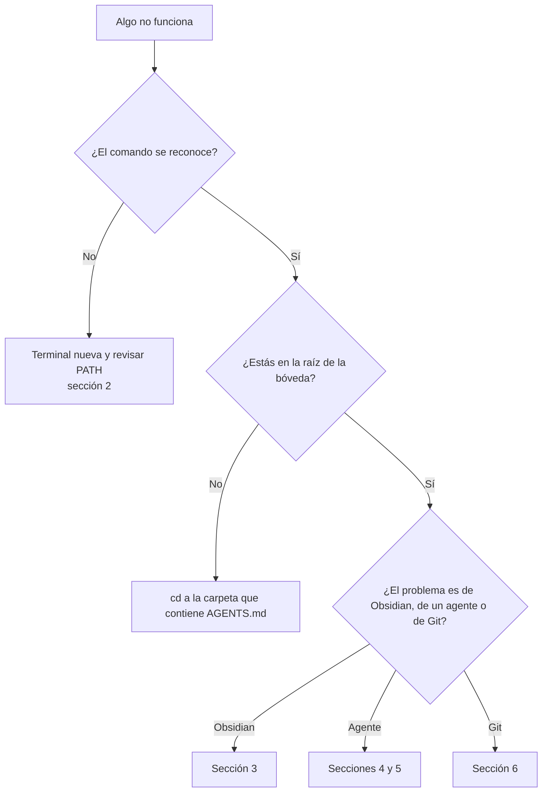

# 13 — Solución de problemas

> **Objetivo:** resolver los problemas más frecuentes. Busca el síntoma en la tabla de su sección.

Anterior: [12 — Seguridad y privacidad](12-security-privacy.md) | [Inicio](../README.md)

---

## 1. Diagnóstico rápido

## 2. Terminal e instalación

| Síntoma | Causa | Solución |
| --- | --- | --- |
| `'git' no se reconoce como un comando...` | Terminal abierta antes de instalar. | Cierra y abre la terminal. |
| `python` abre la Microsoft Store (Windows). | Alias de ejecución de Windows. | *Configuración → Aplicaciones → Configuración avanzada de aplicaciones → Alias de ejecución de aplicaciones*: desactiva `python.exe`, o instala Python con winget. |
| `python3: command not found` en Windows. | En Windows el comando es `python`. | Usa `python`. |
| `'irm' is not recognized` | Estás en CMD. | Usa el comando de CMD o abre PowerShell. |
| `The token '&&' is not a valid statement separator` | PowerShell 5.1 no admite `&&`. | Ejecuta los comandos por separado o usa PowerShell 7. |
| Script bloqueado: *running scripts is disabled on this system* | Política de ejecución de PowerShell. | Para tu usuario: `Set-ExecutionPolicy -Scope CurrentUser RemoteSigned`. Hazlo solo si entiendes la implicación. |

## 3. Obsidian

| Síntoma | Solución |
| --- | --- |
| No aparecen plantillas al insertar. | Activa el plugin *Templates* y configura la carpeta `10-TEMPLATES`. |
| La nota diaria se crea en la raíz o sin plantilla. | *Settings → Daily notes*: carpeta `06-DAILY-NOTES`, plantilla `10-TEMPLATES/daily-note`. |
| Las variables `{{date}}` aparecen literalmente. | Insertaste la plantilla copiando el texto en vez de usar *Templates: Insert template*. |
| Propiedades mostradas como texto. | El `---` inicial debe ser la primera línea del archivo. |
| `area: [[Docencia]]` da error de propiedad. | Pon el enlace entre comillas: `area: "[[Docencia]]"`. |
| Una Base aparece vacía. | Revisa que las notas tengan exactamente la propiedad del filtro (`tipo: proyecto`) y la carpeta correcta. |
| Enlaces rotos tras mover notas con el explorador o un agente. | Mueve desde Obsidian, o pide al agente que actualice los enlaces entrantes. |
| La configuración de `.obsidian/` no se aplicó. | Copiaste la plantilla sin carpetas ocultas. Usa `scripts/new-vault.py` o `robocopy /E`. |

## 4. OpenCode

| Síntoma | Solución |
| --- | --- |
| No aparecen `/procesar-inbox` u otros comandos. | Deben estar en `.opencode/commands/` (plural) y OpenCode abierto en la raíz de la bóveda. |
| No aparecen los agentes. | Deben estar en `.opencode/agents/` con frontmatter válido (`---` al inicio y al final). |
| Ignora `permission`, `bash` o `agent` (singular). | Son claves del formato antiguo. Usa `permissions`, `shell` y `agents`. |
| Edita sin preguntar. | Una regla `allow` posterior anula el `ask`. Recuerda: **la última coincidencia gana**. |
| No puede leer notas. | Una regla `deny` general al final de la lista. Revisa el orden. |
| No aplica las convenciones. | `instructions` apunta a rutas inexistentes; comprueba `99-SYSTEM/rules/`. |
| Error de JSON al iniciar. | Valida el archivo: `python -m json.tool opencode.json`. JSON no admite comentarios ni comas finales (usa `opencode.jsonc` si los necesitas). |

## 5. Claude Code

| Síntoma | Solución |
| --- | --- |
| `claude` no se reconoce. | Terminal nueva; `claude doctor` para diagnosticar. |
| No reconoce `AGENTS.md`. | Si existe `CLAUDE.md`, debe contener la línea `@AGENTS.md`. |
| Las skills o subagentes no aparecen. | Reinicia Claude Code (las carpetas creadas durante la sesión no se cargan). |
| Una importación `@ruta` no funciona. | Escapa espacios con `\`; no la pongas entre comillas invertidas; máximo 4 niveles de importación. |
| Pide confirmación para leer cualquier nota. | Falta `Read` en `allow`, o la carpeta no es el directorio de trabajo. |
| Edita `05-PERSONAL/` | Comprueba con `/permissions` que `Edit(./05-PERSONAL/**)` está en `deny` y que abriste Claude en la raíz de la bóveda (las rutas `./` son relativas a esa carpeta). |
| Aviso de configuración inválida al iniciar. | Ejecuta `claude doctor`: muestra errores de validación de `settings.json`. |

## 6. Git y GitHub

| Síntoma | Solución |
| --- | --- |
| `fatal: not a git repository` | `cd` a la raíz de la bóveda o ejecuta `git init`. |
| `Author identity unknown` | `git config --global user.name "..."` y `git config --global user.email "..."`. |
| `rejected ... (fetch first)` | `git pull --rebase origin main` y luego `git push`. |
| `Authentication failed` | GitHub no acepta contraseñas en la terminal: usa Git Credential Manager o `gh auth login`. |
| Un archivo privado aparece en `git status`. | Añádelo a `.gitignore`. Si ya estaba versionado: `git rm --cached "ruta"` y commit. |
| Ya hice push de un secreto. | [12 — Seguridad, sección 9](12-security-privacy.md#9-si-subiste-un-secreto-o-dato-privado-por-error). |

## 7. Scripts de este repositorio

| Síntoma | Solución |
| --- | --- |
| `new-vault.py`: "ya existe y no está vacía". | Protección intencionada. Elige otra carpeta. |
| `new-vault.py`: "crea la bóveda FUERA de este repositorio". | Protección intencionada para no mezclar notas privadas con la plantilla pública. |
| `install-agents.py`: "OMITIDO (ya existe)". | No sobrescribe. Compara a mano o renombra tu archivo antes de reinstalar. |
| `validate-structure.py` informa errores. | Lee cada línea: indica archivo y problema. |

## 8. Pedir ayuda

Si el problema persiste, abre un issue en el repositorio con: sistema operativo, terminal, versión de la herramienta (`claude --version`, `git --version`, etc.), pasos para reproducirlo y el mensaje de error completo. **Nunca** incluyas API keys ni contenido de tus notas privadas.

---

Anterior: [12 — Seguridad y privacidad](12-security-privacy.md) | [Inicio](../README.md)
