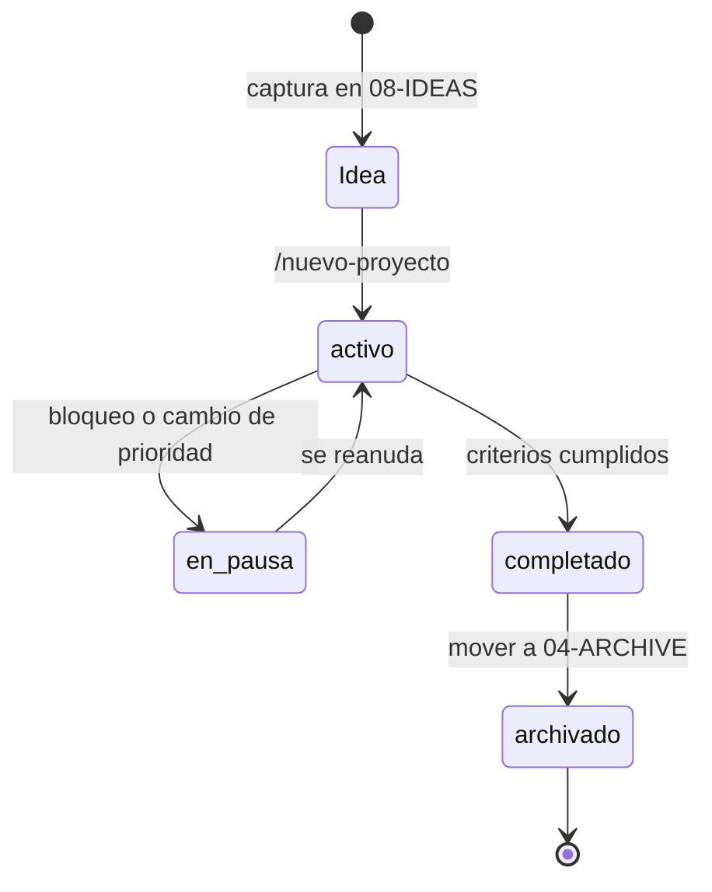

# Proyectos de ejemplo

Cómo se ve un proyecto bien documentado en la bóveda. Todos los datos son ficticios.

## Anatomía de un proyecto

```text
01-PROJECTS/
└── Nombre del proyecto/
    ├── Nombre del proyecto.md     nota principal: objetivo, criterios, acciones, decisiones
    └── Nota de trabajo.md          borradores, temarios, listas (opcional)
07-MEETINGS/
└── AAAA-MM-DD Tema.md             reuniones con  proyecto: "[[Nombre del proyecto]]"
```

| Sección de la nota principal | Pregunta que responde |
| --- | --- |
| Objetivo | ¿Qué existirá cuando termine? |
| Criterios de finalización | ¿Cómo sé que terminó? |
| Alcance | ¿Qué incluye y qué no? |
| Próximas acciones | ¿Qué hago ahora? |
| Contexto | ¿Por qué existe? |
| Recursos | ¿Qué conocimiento usa? (enlaces, no copias) |
| Decisiones | ¿Qué se decidió y por qué? |
| Reuniones | ¿Dónde se habló de él? |
| Registro | ¿Qué pasó y cuándo? |

## Ejemplos

| Proyecto | Estado | Muestra |
| --- | --- | --- |
| [Taller de Python](../example-vault/01-PROJECTS/Taller%20de%20Python/Taller%20de%20Python.md) | activo | Proyecto conectado con reunión, persona, área y notas permanentes dentro de la [bóveda de ejemplo](../example-vault/LEEME-ejemplo.md). |
| [Publicar guía en GitHub](Publicar%20guía%20en%20GitHub/Publicar%20guía%20en%20GitHub.md) | completado | Proyecto terminado, listo para mover a `04-ARCHIVE/`, con lecciones aprendidas. |

## Ciclo de vida


